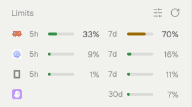

# Agent Limits

A mod for the [Herdr](https://herdr.dev) desktop app: a Limits panel under the Agents list that shows how much of each coding agent's usage limits you have used, one line per agent.



It covers Claude Code and Codex. Each line has two slots: a short window (5 hours) and a long one (7 days, or 30 days for monthly budgets). Plans without a 5-hour limit leave that slot empty. Plans with no limits show "No limit". Usage turns amber at 70% and red at 90%. Hover a line for the reset times.

## What it reads and runs

Read this before installing. The mod's `limits.sh`:

- **Reads your Claude Code sign-in** from the macOS Keychain (`Claude Code-credentials`), or from `~/.claude/.credentials.json` elsewhere. It sends the token to `https://api.anthropic.com/api/oauth/usage`, the endpoint Claude Code's `/usage` screen uses. The token is passed through stdin, never as a command argument.
- **Runs `codex app-server`** briefly and calls its `account/rateLimits/read` method. Codex handles its own sign-in.
- **Reads `~/.codex/sessions/**/*.jsonl`** for the rate limits Codex records after each answer.
- **Writes** its cache to `~/.cache/agent-limits/`.

Accounts signed in with an API key instead of a subscription are skipped.

## Install

Ask your agent to add this repo as a Herdr mod, or do it yourself:

```sh
cp -R mods/agent-limits ~/.config/herdr-app/mods/
herdr-app check ~/.config/herdr-app/mods/agent-limits
```

The mod doesn't dock itself; it goes under the Agents list in your layout. Herdr's own layouts are read-only, so clone yours first if you use one of them, then add the block right after the `agents` block:

```sh
herdr-app do layout.clone '{"name":"main","as":"my-layout"}'   # skip if your layout is already your own
cd ~/.config/herdr-app/layouts
jq '{"id":"agent-limits","type":"block","content":{"mod":"agent-limits"},"size":{"px":106}} as $b
  | walk(if type == "object" and (.children | type) == "array"
         then .children |= [.[] | select(.id != "agent-limits") | if .id == "agents" then ., $b else . end]
         else . end)' my-layout.json > my-layout.json.tmp && mv my-layout.json.tmp my-layout.json
```

### Optional: follow Claude between server checks

The servers are asked at start, every 5 minutes and from the refresh button. To also pick up Claude's numbers after every answer, set the bundled script as Claude Code's statusline in `~/.claude/settings.json`. If you already have a statusline, pass its command after the script and it keeps working:

```json
"statusLine": {
  "type": "command",
  "command": "~/.config/herdr-app/mods/agent-limits/statusline.sh ~/bin/my-statusline"
}
```

## Requirements

- macOS or Linux: `sh`, `jq` and `curl`.
- Windows: PowerShell (`pwsh` or Windows PowerShell) and Codex CLI signed in with ChatGPT for Codex server limits. The mod also detects the Codex app's bundled CLI path from `~/.codex/config.toml`.

Codex local session-log reading and Claude's optional statusline integration are currently supported by the Unix scripts; Windows uses the Codex app-server query and includes `statusline.ps1` for Claude.

## Known limitations

- The Claude usage endpoint is not a public API. A Claude Code update may change it; the panel then shows `!` with the error.
- The endpoint rate-limits. After a 429 the mod waits for the time the server asks (10 minutes if it doesn't say) and shows when it will try again.
- An expired Claude sign-in shows `!` until Claude Code renews it, which happens when you use Claude Code.
- Windows is not supported: the mod runs `sh`.

See "Watch out" in [RECIPE.md](RECIPE.md) for details.

## License

[MIT](LICENSE)
