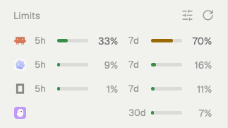

# Agent Limits

A "Limits" panel at the bottom of the sidebar, under the Agents list, with one line per coding agent on this computer: Claude, Codex, OpenCode Go and Kiro. Each line is the agent's icon and two small bars with percentages, the short window (5h) and the long one (7d or 30d), colored green, amber, then red as they fill. Agents that are not running now are dimmed. Resting the pointer on a line opens a card with every window, when it resets and how old the numbers are. A refresh button asks the servers now, and a sliders button opens the settings.



## What you see

The panel is one block. Its background is the theme's `chrome`, with a 1px `border` line on top. Text is 12.5px.

- **Header**, 41px tall (16px side padding, 14px top, 5px bottom). On the left, "Limits" in 11.5px medium, `dim`. On the right, 10px apart: a red `!` (11px semibold, `blocked`) only when a check failed, its tooltip the error lines; the sliders icon (`sliders.svg`, 14px, tooltip "Limits settings"); the refresh icon (`refresh.svg`, 14px, tooltip "Check usage now"). Both icons are `dim` and turn `foreground` on hover. The refresh icon stays `foreground` while it spins.
- **Lines**, one per agent that is turned on and has data, in the order Claude, Codex, OpenCode Go, Kiro. Each is 28px tall, 8px side padding inside an 8px inset, rounded 8px, `hover` background on hover. From left to right:
  - The agent's 14px icon (Herdr's `icons/claude.svg`, `icons/codex.svg`, `icons/opencode.svg`, `icons/kiro.svg`). OpenCode's is drawn as a one-color glyph in `foreground`; the others as images. At 50% opacity when that agent is not running.
  - Two equal cells, 12px apart. The first is the short window (under a day, usually `5h`). The second is the long window (`7d`, `30d`); when there are several (OpenCode Go has 7d and 30d), it shows the fuller one. A missing window leaves its cell empty so lines stay aligned.
  - A cell is the label (22px wide, 11px, `dim`), a 4px bar (rounded 2px, `border` track), and the percentage (30px wide, right-aligned, 11.5px; `muted` when running, `dim` when not; semibold at or above the red threshold or once the limit is reached).
  - Cell width: `max(70, floor((sidebarWidth - 1 - 32 - 14 - 10 - 12) / 2))`; bar width is that less 62px. The sidebar width is read from the layout node with id `sidebar` (240px if there is none).
  - An agent whose plan has no limits shows "No limit" (11.5px, `dim`) in place of the cells.
- **Bar colors**: below "Amber from" (default 50%) the theme's `ansi2` (green); from there `working` (amber); from "Red from" (default 80%) or once the limit is reached, `blocked` (red). With colors off in the settings, bars are `muted` for running agents and `dim` for the rest.
- **Empty panel**: one 12px `dim` line under the header: "No limit data yet.", "Every agent is off in settings.", or "No agent with limits is running." (with "Only agents running now" on).
- **Narrow sidebar** (the `sidebar` node under 160px, the same rule as the shipped agents mod): no header. Each agent is its icon over the percentage of its fullest window (10px, `dim`, semibold when hot), 30px each, 8px apart, centered, starting 10px from the top. An empty panel shows `–` with the empty message as its tooltip.
- **Card** on hover: 256px wide, 14px padding, `popover` background, 1px `border`, 10px corners, large shadow, opening above the line (anchored `bottom_left`). It shows:
  - The icon, the name in 13px semibold, and on the right a detail in 11.5px `dim`: the Console workspace name for OpenCode Go, the plan name (title case) for Kiro.
  - Each window, 12px apart: its name ("5-hour", "Daily", "Weekly", "Monthly") in 12px `muted`; "Limit reached" (11px medium, `blocked`) when hit; the percentage in 13px semibold; a 6px bar (226px wide, rounded 3px); "1,234 of 2,000 credits used" (11.5px `muted`) when the server gives amounts (Kiro); "Resets today 14:35 · in 4h 28m" (11.5px `dim`). Reset times read "today", "tomorrow", a weekday within the week, else "Dec 3 15:26".
  - "No usage limit on this plan." for an unlimited plan.
  - A footer above a 1px line, 11px `dim`: "In use now · Updated 3m ago".
- **Settings popup** (300×600, `popover` background, scrolls). Title "Limits" 13px semibold, then sections with 11px `dim` headings:
  - Agents: a toggle per agent with its icon. Kiro's has the hint "Checked every 15 min; ↻ asks now".
  - Display: "Only agents running now", "Show what's left, not what's used", "Details card on hover", "Animations".
  - Colors: "Color bars by use", "Amber from" 40/50/60/70%, "Red from" 70/80/90/95%. The two pickers are dimmed to 45% when colors are off.
  - Refresh: "Check servers" Off/5m/15m/30m.
  - "Reset to defaults" at the bottom right, 11.5px `muted`.
  - Toggles are 30×18 pills (`accent` on, `input` off) with a 14px knob that slides 160ms. Pickers are segmented controls; the picked one has a `popover` background and a `border`.

## How it behaves

- It does not show agent statuses (working, blocked, done, idle). It only tells running from not running: an agent is running when `agents()` has a terminal whose `app` or `program.key` is `claude-code`/`claude`, `codex`, `opencode`, or `kiro`/`kiro-cli`. Running agents get full-opacity icons and `muted` numbers; the rest are dimmed.
- **Local data** (Claude's statusline cache, Codex's session logs, the cached server answers) is read when the panel starts and every 30 seconds.
- **Server checks** run when the panel starts, every 5 minutes by default ("Check servers": 5m, 15m, 30m or Off), and when you click refresh. Kiro is asked on its own, in parallel with the others, and at most every 15 minutes unless you click refresh.
- During a server check the refresh icon spins (900ms per turn) and stops on a whole turn so it comes to rest upright. The lines being checked fade to 50% opacity (260ms) and return when the answer arrives. Bars slide to their new widths over 700ms (ease-out). With "Animations" off there is no spin, slide, fade or knob motion.
- A window whose reset time has passed shows 0% and the card says "New window started" until the next check.
- With "Show what's left" on, every percentage and bar shows 100 minus the use, and the card adds " left".
- Hovering a line for 350ms opens the card; it closes 150ms after the pointer leaves. With the card turned off, a tooltip gives the name and numbers instead, e.g. "Claude · 5h 42% · 7d 13%".
- Clicking the sliders icon opens the settings as a popup at the pointer. Each change is saved at once and every copy of the panel follows it. Turning an agent on fetches its numbers right away. Choosing an amber value at or above the red one moves red up to the next option, and the other way around.
- When the layout gives the block a fixed height (`size.px`), the panel resizes its block to fit its lines: `41 + max(lines, 1) × 28 + 8` px, or `20 + n × 30 + (n − 1) × 8` px in the narrow rail.
- Failed checks put a red `!` in the header. The other numbers stay up from the local data or the last cached answer.

## Built from

- **Files:** `mods/agent-limits/` with `main.js` (the panel and the settings), `limits.sh` (collects the numbers), `statusline.sh` (optional Claude Code statusline hook), `mod.json` = `{ "place": "none", "title": "Limits" }`, and two Lucide icons drawn in `currentColor`: `sliders.svg` (sliders-horizontal) and `refresh.svg` (rotate-cw).
- **Layout:** `"place": "none"` means it never docks itself. Add a block to the sidebar column, under the agents block, with a fixed height so it can fit itself. In the example layout it sits in the `sidebar-lists` column after `agents`:

  ```json
  {
    "id": "agent-limits",
    "type": "block",
    "content": { "mod": "agent-limits" },
    "size": { "px": 134 }
  }
  ```

  The sidebar column must have the id `sidebar` for the width and narrow-rail rules to work.
- **Props:** `{ "settings": true }` turns a copy into the settings view. The panel opens that itself with `openOverlay({ mod: "agent-limits", kind: "popup", width: 300, height: 600, props: { settings: true } })`. The layout block needs no props.
- **herdr functions:** `agents()`, `exec("sh", [appHome() + "/mods/agent-limits/limits.sh", "--agents", "claude,codex,opencode", "--live", "--force"])`, `appHome()`, `theme()`, `layout()`, `props()`, `run("layout.resize", { id, px })`, `shared("agent-limits.settings")` / `setShared(...)`, `openOverlay(...)`.
- **gpui-kit / gpui-base:** `View`, `div`, `image`, `svg`, `v_flex`, `h_flex`, `HoverCard` (anchor `bottom_left`, open delay 350, close delay 150), `Toggle`; `.transition("width" | "opacity" | "left", …)` and `.spin(900)`.
- **Settings** live in shared state under `agent-limits.settings`: `agents` (per agent, all true), `running_only` false, `remaining` false, `card` true, `motion` true, `colors` true, `mid` 50, `high` 80, `every` 5 (minutes, 0 = off). "Reset to defaults" sets the key to null.
- **`limits.sh`** prints a JSON array: `[{agent, name, detail?, updated_at, unlimited?, windows: [{label, minutes, pct, resets_at, limited?, used?, limit?, unit?}]}]`. Flags: `--agents a,b` (which agents), `--live` (ask the servers first and cache the answers), `--force` (ask Kiro even if its cache is under 15 minutes old). Errors go to stderr; the panel shows them in the `!` tooltip. Rows without windows are dropped unless `unlimited`.
  - Claude: the newer of the statusline cache (`claude.json`) and the server cache (`claude-server.json`). Windows `five_hour` (5h), `seven_day` (7d), and `spend_limit` (daily, weekly or monthly) when the statusline reports one.
  - Codex: the newer of the server cache and the latest `token_count` event carrying `rate_limits` in the 10 most recently modified `*.jsonl` files under `~/.codex/sessions` changed in the last 8 days.
  - OpenCode Go and Kiro: only their cached server answers.
- **Programs it runs:** `sh`, `jq`, `curl`, `security` (macOS), `mkfifo`, `mktemp`, `find`, `grep`, `sed`, `pkill`, and if installed `codex`, `opencode`, `kiro-cli`.

## Watch out

- **Credentials it reads.** Claude: the macOS Keychain item `Claude Code-credentials` via `security find-generic-password -s "Claude Code-credentials" -w`, or `${CLAUDE_CONFIG_DIR:-~/.claude}/.credentials.json` where there is no Keychain. Only `claudeAiOauth.accessToken` is used. It is passed to curl on stdin, so it does not show in the process list. Codex: only the `auth_mode` field of `${CODEX_HOME:-~/.codex}/auth.json`, to skip API-key accounts. OpenCode and Kiro use their own CLIs' sign-ins; the script does not read their credential files.
- **Files it reads outside its folder:** the two Claude credential sources above, `~/.codex/auth.json`, and `~/.codex/sessions/**/*.jsonl`. It writes only to `${XDG_CACHE_HOME:-~/.cache}/agent-limits/` (`claude.json`, `claude-server.json`, `claude-wait-until`, `codex.json`, `opencode.json`, `kiro.json`).
- **Servers it calls** (only on server checks):
  - Claude: `GET https://api.anthropic.com/api/oauth/usage` with header `anthropic-beta: oauth-2025-04-20`. This endpoint is undocumented and can change. After an HTTP 429 it waits for `Retry-After` (10 minutes when there is none) before asking again. A 401 says "sign-in expired; open Claude Code to renew it".
  - Codex: starts `codex app-server` locally and sends JSON-RPC `initialize` then `account/rateLimits/read`; Codex asks OpenAI's servers. Only when `auth_mode` is `chatgpt`.
  - OpenCode Go: `opencode api experimental.usage.limits`, which asks the OpenCode service for the signed-in Console workspace. It is an experimental command. A workspace without a Go subscription removes the row.
  - Kiro: starts `kiro-cli acp` in `$HOME`, creates a session (`session/new`), runs the `usage` slash command (`_kiro.dev/commands/execute`), then deletes the session with `kiro-cli chat --delete-session`. No prompt is sent, so no credits are spent. Starting the session also starts the MCP servers configured in Kiro, which is why it runs at most every 15 minutes.
- **`statusline.sh` is optional and you wire it yourself.** Without it, Claude's numbers come only from server checks. To follow Claude after every answer, set it as Claude Code's `statusLine` in `~/.claude/settings.json`. Pass your existing statusline command as arguments and it is run with the same input:
  `"statusLine": { "type": "command", "command": "~/.config/herdr-app/mods/agent-limits/statusline.sh ~/bin/my-statusline" }` (`~/bin/my-statusline` is a placeholder). It writes `claude.json` in the cache folder only when `rate_limits` changes.
- **Accounts without a subscription sign-in** (API keys) are skipped without an error. Their lines do not appear.
- **`jq` is required.** Without it the script prints nothing and the panel shows an error. `limits.sh` adds `/usr/bin:/bin:/opt/homebrew/bin:/usr/local/bin` to `PATH`.
- **Time limit.** `exec` stops a program after 30 seconds. Codex and OpenCode wait up to 15 seconds each. Kiro waits up to 30 seconds for its session and another 30 for `/usage`, so a slow Kiro check can be cut off by that limit. That is one reason Kiro runs in its own `exec`.
- **Fixed names.** The folder must be `mods/agent-limits/`: `main.js` builds the script path from `appHome()` and loads `mods/agent-limits/sliders.svg` and `refresh.svg` by that path, and `fit` looks for the block whose `content.mod` is `agent-limits`. If you rename the folder, change those strings too. The agent icons come from Herdr's own `icons/` folder; they are not shipped with the mod.
- **Fitting** happens only when the block has `size.px`. With `weight` the block keeps the size the layout gives it. Only the first `agent-limits` block in the layout is resized.
- **Fresh builds tend to get these wrong:** a local read that finishes after a newer run must not put older numbers back (main.js numbers each run and skips stale local results). Kiro must not hold up the other agents. The settings copy must not start timers or run checks (`init` returns early when `props().settings`).
- **Limits:** four agents, fixed in `AGENTS`. One short and one long cell per line; extra long windows appear only in the card. Kiro's credits are treated as a monthly window that resets on the billing cycle date at 00:00 UTC.
- Some Codex log events carry `rate_limits` with `primary: null`; don't take the last line blindly.
- The Claude statusline repeats the last answer's numbers on every redraw. Stamping each redraw as new data would bury a fresher server answer; only write when the value changes.
- The usage endpoint answers 429 when asked too often. Every save of a mod file reloads the mod and triggers a server check, so editing quickly can hit it. Store `now + Retry-After` (10 minutes if missing or a date) and skip Claude until then.
- `label` is a jq keyword; name helper functions something else.
- Put the user's `PATH` first: several `codex` installs may exist, and the one they use is the one that knows their sign-in.
- A label like "30d" wraps in a narrow column; give labels 22 px and `whitespace_nowrap()`.
- The code was written and tested on macOS. On Linux the Keychain step is skipped and Claude falls back to `.credentials.json`.

## Done when

- `sh ~/.config/herdr-app/mods/agent-limits/limits.sh` prints a JSON array, `[]` when no agent has data, and exits 0.
- `sh limits.sh --agents codex` prints a Codex row with `5h` and `7d` windows after a Codex session has run in the last 8 days.
- `sh limits.sh --live --agents claude` writes `~/.cache/agent-limits/claude-server.json` when signed in to Claude Code with a subscription, and prints a Claude row.
- `herdr-app check agent-limits` passes, and the panel shows under the Agents list with one line per agent that has data.
- Agents not running in Herdr have half-opacity icons. Starting one in a terminal brings its icon to full opacity.
- Hovering a line for about 350ms opens the card with every window, its reset time and "Updated … ago".
- Clicking refresh spins the icon, fades the lines, and the bars slide to the new values. A failed check shows the red `!` with the error as its tooltip.
- The sliders icon opens the 300×600 settings. Turning an agent off removes its line in every copy. "Show what's left" flips the numbers. "Reset to defaults" restores them.
- With a `size.px` block, the block's height becomes `41 + lines × 28 + 8` px. Narrowing the sidebar below 160px switches to the icon-over-percentage rail.
- With `statusline.sh` set as Claude Code's `statusLine`, `~/.cache/agent-limits/claude.json` updates after a Claude answer and the Claude line follows within 30 seconds.
